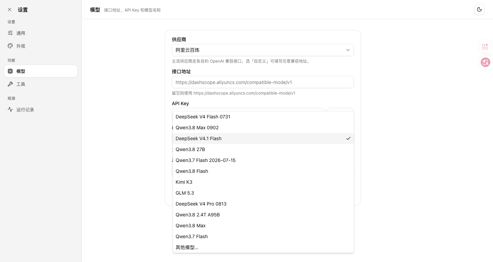
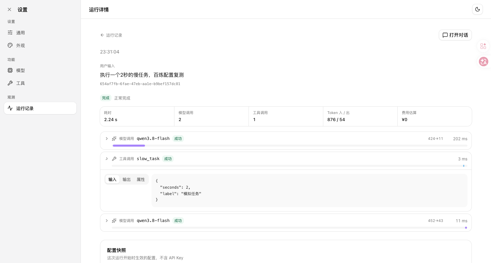
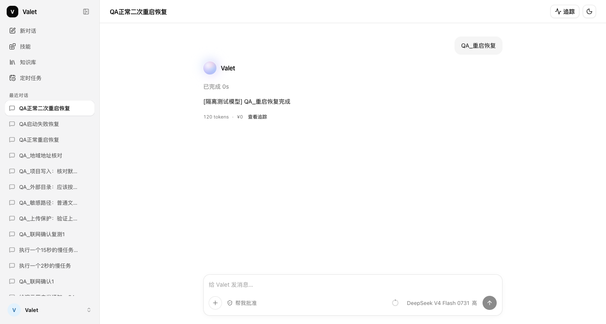

# Ego Lite 四项复测与百炼模型配置 · 2026-10-12

已把截图中的 12 个百炼模型加入当前项目，其中新增 9 个；全部 12 个真实连接探针通过，现有页面已生效。当前默认模型仍为 `deepseek-v4.1-flash`，原有 12 次运行、7 个会话及工具配置数量已在后端重启前后核对保留。

本次验收范围按用户补充限定为阿里云百炼。其他供应商尚未对接，不作为当前接入失败项；早期跨供应商测试仅使用假密钥和脚本模型，没有向其他供应商发出真实请求。

| 四项检查 | 通过的部分 | 尚未通过 |
| --- | --- | --- |
| 密钥与模型配置 | 12 个百炼模型真实连接通过；设置保存与刷新后保留；新增模型可以在界面选择并保存；15 秒流空闲会停止并显示原因 | Mock 切换仍需重启，响应正文标明模拟模型；可以补独立的模式标识。地域环境地址优先级另列为配置边界 |
| 工具开关与确认 | 禁用工具被拦截；确认前不执行，拒绝后不执行，本次允许后执行；联网会话授权可以复用 | 上传原件的只读路径绕过、相对敏感路径绕过、首次重启重新启用文件工具、`ls` 未按目标路径请求确认 |
| 追踪与导出 | 界面可查状态、错误、输入参数和 Token；JSON 详情 API 可手工保存且快照不含密钥 | 工具耗时不准；取消运行缺工具步骤；无产品内下载入口 |
| 定时任务持久化 | 从页面创建、刷新后保留；真实停止并重启进程后，任务恢复并按默认 20 秒轮询触发，页面能查看完成结果 | 单次任务启动失败后被停用，未创建运行，没有持久化错误与重试入口 |

## 百炼模型结果

调用项目现有“测试连接”接口，参数 `max_tokens=1`，使用当前百炼凭据。此结果证明当前接口可接受对应模型请求，不代表逐模型完成工具、图像或长任务质量验收。

| 模型 ID | 目录变更 | 真实连接 | 探针耗时 |
| --- | --- | --- | --- |
| `deepseek-v4-flash-0731` | 原有 | 通过（HTTP 200） | 1.77 秒 |
| `qwen3.8-max-0902` | 原有 | 通过（HTTP 200） | 4.42 秒 |
| `deepseek-v4.1-flash` | 原有 | 通过（HTTP 200） | 2.36 秒 |
| `qwen3.8-27b` | 新增 | 通过（HTTP 200） | 9.99 秒 |
| `qwen3.7-flash-2026-07-15` | 新增 | 通过（HTTP 200） | 4.10 秒 |
| `qwen3.8-flash` | 新增 | 通过（HTTP 200） | 8.80 秒 |
| `kimi-k3` | 新增 | 通过（HTTP 200） | 1.40 秒 |
| `glm-5.3` | 新增 | 通过（HTTP 200） | 1.78 秒 |
| `deepseek-v4-pro-0813` | 新增 | 通过（HTTP 200） | 0.71 秒 |
| `qwen3.8-2.4t-a95b` | 新增 | 通过（HTTP 200） | 9.01 秒 |
| `qwen3.8-max` | 新增 | 通过（HTTP 200） | 7.69 秒 |
| `qwen3.7-flash` | 新增 | 通过（HTTP 200） | 5.96 秒 |

代码仅在 [providers.py](../services/agent-api/src/agent_api/llm/providers.py#L70) 追加模型目录。新增模型价格保持未核实状态，没有把账号免费额度写成永久零单价，也未修改 `.env` 或当前默认模型。

## 8 个未通过项

1. **上传只读保护**：通过页面上传专用测试文件，模型用 `.valet/sessions/.../uploads/...` 的实际路径先读后写，上传原件被覆盖。只涉及隔离测试文件。
2. **敏感文件保护**：`../outside/.env` 被当作普通项目外文件请求授权，点击本次允许后能读取假敏感内容。真实密钥文件未参与测试。
3. **工具开关重启保持**：页面关闭全部工具，进程从 `57947` 重启为 `58954` 后，6 个文件与技能工具重新开启。
4. **外部目录列出**：`ls` 没有生成目标目录授权卡，执行阶段却返回需要授权的错误。
5. **工具耗时**：百炼模型配置下的隔离运行，慢任务参数为 2 秒，整轮耗时 2243 毫秒，工具步骤只记 3 毫秒。
6. **取消记录**：在慢工具运行中点击停止，运行标记为取消，但没有该工具的取消步骤。
7. **导出入口**：详情 JSON API 可读取并手动保存，界面无下载按钮，外部导出器仍为空实现。
8. **任务启动失败重试**：恢复到期单次任务后，模拟运行创建失败；任务已停用、下次时间被清空，实际运行数为 0，也没有任务错误字段。

## 重启恢复证据

页面创建的单次任务 `a2440f1d-46f2-49e6-a56d-5bebedb8aaeb` 在进程 `59991` 停止时尚未触发。新进程 `60223` 恢复同一条任务及原下次触发时间，随后创建并完成运行，页面出现“QA_重启恢复完成”。测试使用默认 20 秒轮询周期，没有通过数据库修改触发时间或手工调用调度函数。

另一次预备任务因测试期间补充需求而在停止进程前已触发，没有将它计作重启恢复证据；上述证据来自重新创建并在到点前停止进程的独立任务。

## 测试与交付边界

- 共记录 43 条检查：31 条通过、8 条未通过、2 条行为观察、1 条范围外边界、1 条可选配置边界。12 个真实模型探针包含在通过项中。
- 推送前后端全量回归：73 项通过；Ruff 和 Git 差异格式检查通过。新增目录沿用现有调用链；一并提交工作区已有的 SOCKS 代理兼容修复，将 `httpx[socks]` 列为运行依赖并包含对应回归测试。默认模型未改变。
- 网页操作均通过 Ego Lite 的同一 TaskSpace 完成，包含填表、开关、确认、拒绝、上传、停止、刷新与截图。后台状态读取也使用浏览器请求。
- 真实服务只用于当前配置读取与最小模型连接探针。故障注入、文件写入、授权边界与任务重启在独立前后端和临时 SQLite 中测试；该环境使用脚本模型以及固定联网结果，不产生真实通知或外部搜索。
- 当前真实后端已用原 SQLite 数据库重启并加载新目录。测试创建的 Ego Lite 页面、隔离后端与前端服务已关闭；日常 8000 和 5173 服务保留。
- 功能变更为新增百炼模型目录，并同步已有的 SOCKS 代理兼容修复。上述 8 个问题已测试和记录，尚未修复。

[完整结构化证据](egolite-results-2026-10-12.json) · [最初代码检查报告](audit-four-items-2026-10-12.md)

尚未验证：各模型真实业务任务的工具选择、图像输入与长时间稳定性；账号免费额度余额及实际账单也未查询。
